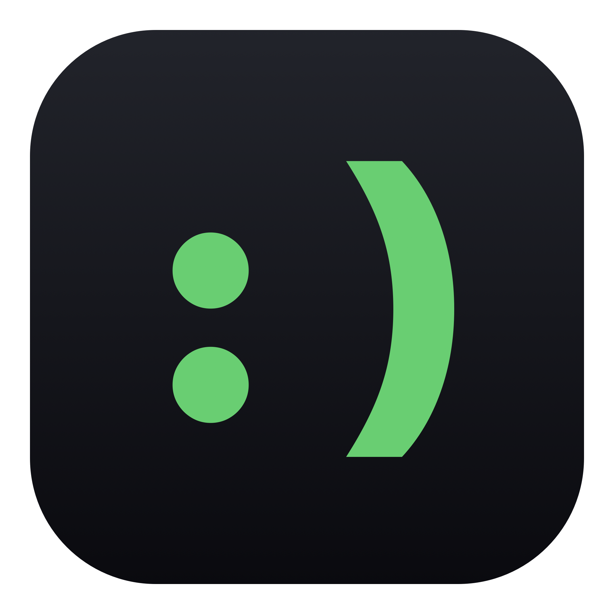

<p align="center"></p>

# iStats

A tiny performance overlay for Mac games. Shows CPU, GPU, memory and chip temperature on top of your game, with colors that go green, yellow, orange, red as things heat up.

- Floats above fullscreen games. Clicks pass through to the game.
- Lives in the menu bar as `:)`. Hide or show the overlay from there.
- Record a session: get a summary (average and max) and a CSV saved in `~/Documents/iStats`.
- Reads numbers from macOS only. It never touches the game's process.

## Install

1. Download `iStats.zip` from the [latest release](../../releases/latest) and unzip it.
2. Move `iStats.app` to Applications.
3. First launch: right-click the app, choose Open. (The app is not notarized, so macOS asks once.)

Requires an Apple Silicon Mac on macOS 14 or newer.

## Use

- Double-click the overlay to unlock it, drag it where you want, double-click again to lock.
- Menu bar `:)` for Hide Overlay, Start/Stop Recording, Horizontal Layout (one row instead of a stack), Quit.

## Build

```bash
./build.sh
```

Output goes to `dist/`. Needs Xcode command line tools.

## Support

If iStats is useful, you can [buy me a coffee on Ko-fi](https://ko-fi.com/wynix).

## License

MIT
